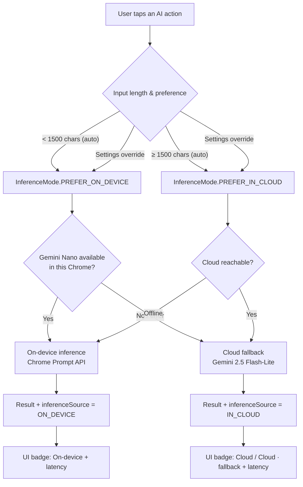

# NoteHybrid — notes that think locally first

**NoteHybrid** is a smart notes app whose AI is *hybrid by design*. Short,
private drafts are processed **on your own device** (Gemini Nano in Chrome —
fast, offline, nothing leaves the machine). Long documents are routed to a
**cloud Gemini model**. The switch is automatic, the fallback works in both
directions, and — unlike most "hybrid" demos — **every AI result shows an
honest badge with where inference actually ran** (reported by the SDK's
`inferenceSource`, not by what we requested) plus the latency.

Built for students, creators, and small teams who draft sensitive notes and
work on flaky connections.

> Built with **Firebase AI Logic** hybrid inference for the
> **#BuildHybridAI 2026** hackathon (Web/Chrome platform).

**Live demo:** https://aldy007x.github.io/notehybrid/

## Features

- **Accounts** — email/password and anonymous guest sign-in (Firebase
  Authentication).
- **Notes that sync and work offline** — full CRUD in Cloud Firestore with
  offline persistence (multi-tab local cache): search, pin, archive,
  autosave. On a train with no signal, you keep writing; sync resumes when
  you're back.
- **Hybrid AI actions on any note**
  - ✦ **Summarize** — 2–4 sentence summary
  - ☰ **Key points** — bulleted extraction
  - ✎ **Rewrite & expand** — cleaner, structured, elaborated draft
  - 🌐 **Translate ID ↔ EN** — auto-detects Indonesian vs English and
    translates to the other
- **Honest routing UI** — each result carries an `On-device` / `Cloud` /
  `Cloud · fallback` badge driven by the SDK-reported `inferenceSource`,
  plus measured latency. If on-device was requested but unavailable, the UI
  says the cloud served it. Nothing is faked.
- **Ask my notes** — streaming chat grounded in your notes (titles + bodies
  as context), routed cloud-first (on-device inference is single-turn only).
- **Hybrid status panel** — live check of Gemini Nano availability in the
  current browser via Chrome's Prompt API (`LanguageModel.availability()`),
  plus the active routing policy.
- **Settings with Remote Config** — inference preference
  (`auto` / `on-device` / `cloud`) defaults come from Firebase Remote Config
  and can be overridden locally per device.
- **App Check** — initialized with the debug provider when
  `FIREBASE_APPCHECK_DEBUG_TOKEN` is present, reCAPTCHA v3 otherwise;
  failures never crash the app.
- **Dark mode**, empty states, loading states, error toasts — a complete
  product, not a proof of concept.

## How hybrid routing works



Rules, concretely (see `src/lib/ai.ts`):

1. A fresh hybrid `GenerativeModel` is created per request with
   `getGenerativeModel(ai, { mode, inCloudParams: { model: "gemini-3.5-flash-lite" } })`.
2. `mode` is `PREFER_ON_DEVICE` for inputs under the threshold
   (Remote-Configurable, default 1500 chars) and `PREFER_IN_CLOUD` above
   it — unless the user overrode the preference in Settings.
3. `model.initializeDeviceModel()` is called after the user interaction,
   before the request, as the Firebase hybrid guide requires.
4. The badge reads `result.response.inferenceSource` — the SDK's own report
   of where the request actually ran.

## Tech stack

- Vite + React 19 + TypeScript
- Firebase JS SDK (modular): **AI Logic** (`firebase/ai`), Authentication,
  Firestore (offline persistence), Remote Config, App Check
- Hand-rolled CSS with variables (light/dark themes) — no CSS framework

## Setup

### 1. Create a Firebase project

1. In the [Firebase console](https://console.firebase.google.com), create a
   project (or reuse one).
2. Go to **AI Services → AI Logic → Get started** and choose the
   **Gemini Developer API** provider. This workflow also enforces
   **App Check** for AI Logic.
3. Enable **Authentication** providers: Email/Password and Anonymous.
4. Create a **Cloud Firestore** database.
5. (Optional) In **Remote Config**, publish `inference_preference`
   (`auto` | `on-device` | `cloud`) and `ai_on_device_max_chars` (default
   `1500`) to change routing policy without redeploying.
6. Register a **Web app** and copy its config.

### 2. Configure the app

Paste your web config into **`src/firebase-config.ts`** (the only file you
need to edit):

```ts
export const firebaseConfig = {
  apiKey: "...",
  authDomain: "...",
  projectId: "...",
  storageBucket: "...",
  messagingSenderId: "...",
  appId: "...",
};
```

Until you do, the app runs in **demo mode**: local-only notes, guest
session, AI disabled with an explanatory banner — handy for exploring the
UI.

For App Check in production, register reCAPTCHA v3 in the console and put
the site key in `appCheckSiteKey` in the same file.

### 3. App Check debug token (local development)

AI Logic enforces App Check, so for localhost either use the site key
above or a debug token:

1. In your browser console, before loading the app, set:
   `self.FIREBASE_APPCHECK_DEBUG_TOKEN = true`
   (or paste a specific token string).
2. Load the app — the debug token is printed in the console.
3. In the Firebase console → **App Check → Apps → ⋮ → Manage debug
   tokens**, register that token.

NoteHybrid registers the `ReCaptchaV3Provider`; when the debug-token
global is set before init, the Firebase v13 SDK internally switches App
Check to debug mode and returns the debug token instead of performing
attestation (there is no separate `DebugProvider` export in v13). App
Check init is wrapped in try/catch so a missing configuration never
crashes the app.

### 4. Run

```bash
npm install
npm run dev      # http://localhost:5173
npm run build    # production build into dist/
```

### 5. Try on-device inference

On-device inference needs **Chrome 139+ on desktop**:

1. Enable `chrome://flags/#prompt-api-for-gemini-nano-multimodal-input`,
   restart Chrome.
2. In DevTools console: `await LanguageModel.availability()` — if
   `downloadable`, run `await LanguageModel.create()` to download Gemini
   Nano.
3. In NoteHybrid, watch the **Hybrid status** panel turn green, then
   summarize a short note — the badge should read **On-device**.

### Firestore security rules (suggested)

```
rules_version = '2';
service cloud.firestore {
  match /databases/{database}/documents {
    match /users/{uid}/notes/{noteId} {
      allow read, write: if request.auth != null && request.auth.uid == uid;
    }
  }
}
```

## Screenshots

<!-- TODO: add screenshots before submission -->
- _Notes workspace with hybrid AI bar_ — `docs/screenshots/workspace.png`
- _AI result with on-device badge_ — `docs/screenshots/on-device-badge.png`
- _Ask my notes (streaming)_ — `docs/screenshots/ask.png`
- _Dark mode_ — `docs/screenshots/dark.png`

## Project layout

```
src/
  firebase-config.ts   ← paste your Firebase config here (only edit needed)
  lib/
    firebase.ts        app/Auth/Firestore(+offline)/Remote Config/App Check init
    ai.ts              hybrid routing layer (Firebase AI Logic)
    notes.ts           notes data layer (Firestore + local demo backends)
    store.tsx          app state: auth, notes, settings, theme, toasts
  components/          AuthScreen, NoteList, NoteEditor, AskNotes,
                       HybridStatus, SettingsModal, shared UI
```

## License

Apache-2.0 — see [LICENSE](LICENSE).
